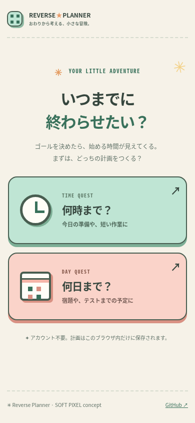
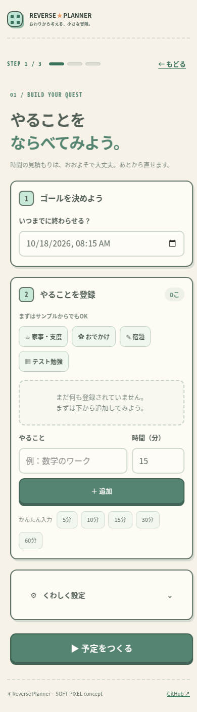
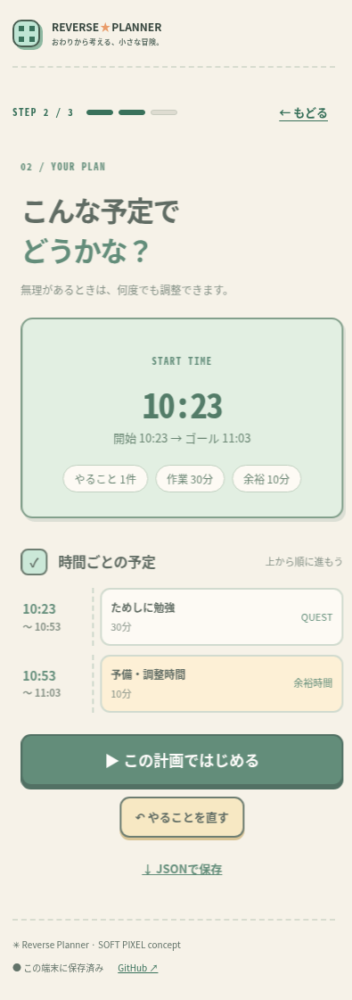
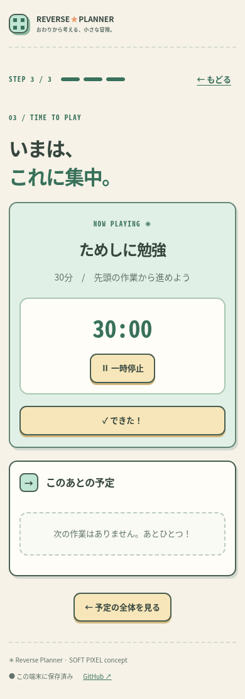
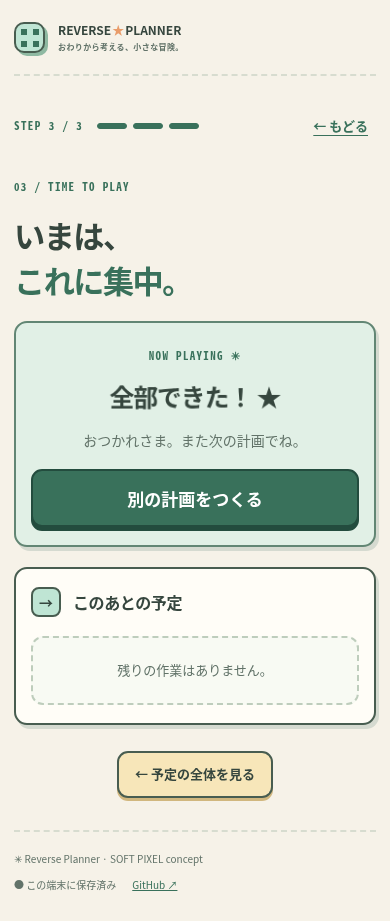

# APP-004 | モバイル画面プレビュー

These images show **Chromium with fictional demo data**, not iPhone Safari.
This gallery is updated on passing CI for APP-004 PR #3 and does not publish or modify the production site.
The previously approved cat logo has not been added: the actual approved original is not yet available.

## 1. HOME

[画像を単独で開く](./home-390.png)

## 2. SETUP

[画像を単独で開く](./setup-mobile.png)

## 3. PLAN

[画像を単独で開く](./clock-plan-mobile.png)

## 4. RUN

[画像を単独で開く](./timer-mobile.png)

## 5. DONE

[画像を単独で開く](./done-mobile.png)

## 文字約200%の検証

- [HOME・390px](./home-text200-390.png)
- [SETUP・320px](./setup-text200-320.png)
- [PLAN・320px](./plan-text200-320.png)
- [RUN・320px](./run-text200-320.png)

All images are reproducible synthetic-test artifacts. Chrome viewport checks do not replace native iPhone Safari, VoiceOver or zoom verification.

Source PR code commit: 8fc2ea4bf17f46c7ea9b76111bf28b57cef92082
